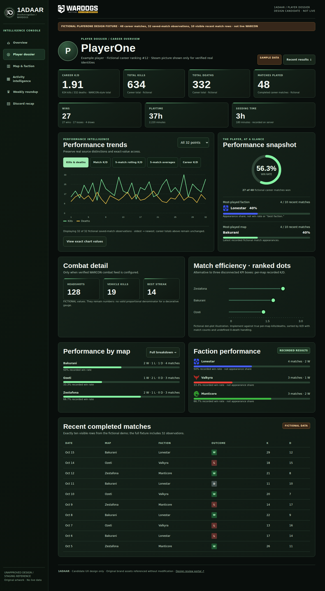
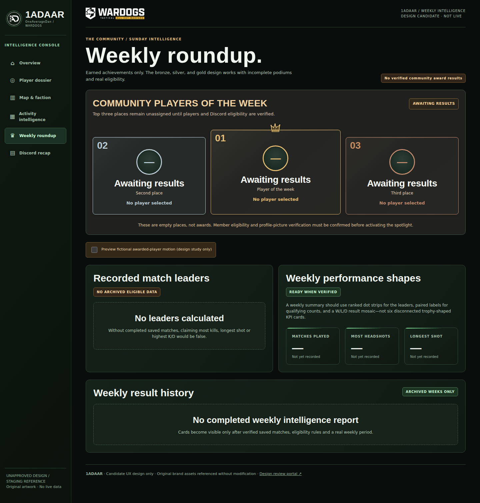

# 1ADAAR v1.1.0
### The next version of the WARDOGS after-action report

[1ADAAR today](https://ejronin.github.io/1ADAAR/) · [Six-screen design preview](prototypes/index.html) · [Screenshots](screenshots/) · [Design PR #28](https://github.com/ejronin/1ADAAR/pull/28)

The next version is about making the information we've been collecting more useful—and making the site feel like it belongs to **OneAverageDan and WARDOGS**, rather than a standard statistics template.

I wanted the match history and career totals to be easy to understand at a glance, with the deeper details there when someone wants them. That means fewer disconnected number cards, better explanations for charts, and a consistent look from the home page through Discord recaps.

These are **editable design previews**. The working implementation, live data integration and final approval are separate steps. Nothing here should be mistaken for a feature already running in production.

## A clearer look at each player

The player page keeps the figures people usually look for first: K/D, kills, deaths and matches. It then shows recorded results over time, wins, map and faction performance, combat details where WARCON has them, and a more useful record of recent matches.

The trend charts have specific jobs. Raw kills and deaths can be compared match by match with a paired-dot chart. A **trailing five-match K/D** point combines the current match with the four before it. The 10/20/all selector changes how many points are visible, not the five-match calculation. A control disappears when it doesn't apply to the selected chart.

PlayerOne appears in the screenshots because it is a **fictional test profile**, used to test the layout and calculations without passing sample figures off as real player records.

## The map and faction picture

The map page compares **recorded K/D by map**, wins and losses, faction appearances and match outcomes. The important detail is the denominator: a good ratio across three recorded matches isn't the same as one built from dozens.

Where a control changes only one part of the page, it sits with that section. Original Lonestar, Valkyra and Manticore emblems and colors stay consistent throughout.

[See the map and faction design](prototypes/map-team.html)

## A weekly report worth looking back at

The weekly view brings the familiar podium back: silver second place, a taller gold first-place card with the small crown, and bronze third place. The metal finish is subtle instead of flashy. Names and pictures appear only when the saved matches actually support the result.

The archive should be something the community can return to, not just a message that disappears up a Discord channel. An empty week stays empty; a sample crown animation doesn't manufacture a winner.

[See the weekly design](prototypes/weekly.html)

## More life in the home page, less visual noise

The home screen keeps the real 1AD emblem and WARDOGS artwork. A short laser traces the hero border once and disappears. A metallic light passes **within the actual shape of the 1AD logo**; it does not move an oversized copy across the banner.

The rest of the layout is quieter so the current server information, recorded match results and player lookup remain easy to find. Animations can be disabled for reduced motion.

[See the home design](prototypes/home.html)

## Activity that means something

The activity view shows when **completed matches were recorded as starting**. It's useful for spotting patterns across days and hours, but it isn't a measure of when one particular person was online.

A personal online-time heatmap is a separate possibility. It needs actual join and leave times, reasonable history coverage and permission to use those records. Without that, there's no reason to color in a calendar and pretend we know.

[See the activity design](prototypes/activity.html)

## Optional account progression

WARDOGS Tracker documents a separate public API for players who sign in with Steam and synchronize their game profile. That opens the door to an optional section showing **six role levels and XP, overall WARDOG level, career XP, and account cash/gold when visible**.

It would be a player choice, not a requirement for using 1ADAAR. The six-role radar remains empty until real values can be retrieved and matched to a consenting player. Cash and gold stay hidden when the source hides them. The external sync link already exists in the design, but an automatic account connection or return flow has **not** been established.

The [role-data research](research/ROLE_PROGRESSION_ACCESS_VALIDATION.md) explains what was found, and the [connection plan](research/PLAYER_PROGRESSION_OPT_IN_IMPLEMENTATION.md) covers the remaining identity and privacy work.

## The Discord side

The after-action recap is meant to work **inside Discord**, not just resemble a Discord message in a browser. The design includes the report image, a genuine link-button specification for opening 1ADAAR, and a top recorded-kills player for each faction when the completed-match data supports it.

The finished message still needs to be rendered and checked in real Discord clients.

[See the recap design](prototypes/recap.html)

## How the next version is built

1ADAAR keeps the existing GitHub approach. WARCON supplies recorded match data, Python jobs prepare the public results, GitHub Pages serves the site, and browser JavaScript/SVG handles the charts. Python also draws the Discord recap artwork.

I've looked at Sass, Vite, D3, ECharts and other libraries for improving the experience. The point isn't to add technology for its own sake. The [technology review](research/FRONTEND_GRAPHICS_TECHNOLOGY_ASSESSMENT.md) explains which tools would actually help and why desktop GUI libraries such as Kivy or Tkinter don't fit a GitHub Pages website.

### Inside this folder

The design is kept here as editable source, not just screenshots:

| Folder or file | What's there |
|---|---|
| [prototypes/](prototypes/) | Six HTML pages with shared CSS and JavaScript |
| [screenshots/](screenshots/) | Real desktop/mobile browser captures and labeled sample interactions |
| [components/](components/) | SVG artwork, charts, data adapters and tests |
| [screen-manifest.json](screen-manifest.json) | The relationship between designs, source files and implementation files |
| [tokens.final.json](tokens.final.json) | Proposed fonts, colors, spacing and other shared styles |
| [research/](research/) | Findings on charts, data access, player connections and frontend tools |
| [tools/](tools/) | Screenshot and image generators, plus validation tests |

The prototypes can be viewed from a local repository checkout with `python -m http.server 8000`, then opening `http://localhost:8000/design/v1.1.0/prototypes/index.html`.

The screenshots come from browser runs at 390px and 1440px, with layout checks at 320, 375, 768 and 1024px as well. Those checks confirm how the **design source** renders; they don't prove that the implementation matches or that live Discord and WARCON connections are working.

For exact measurements, data rules and component behavior, the [component specifications](components/COMPONENT_IMPLEMENTATION_SPEC.md) and [chart notes](research/CHART_METHODS_AND_FIELD_GATE.md) have the detail.

---

**Current status:** design handoff in [PR #28](https://github.com/ejronin/1ADAAR/pull/28). The implementation is being handled separately in staging. The existing public site remains live while the next version is built and reviewed.
